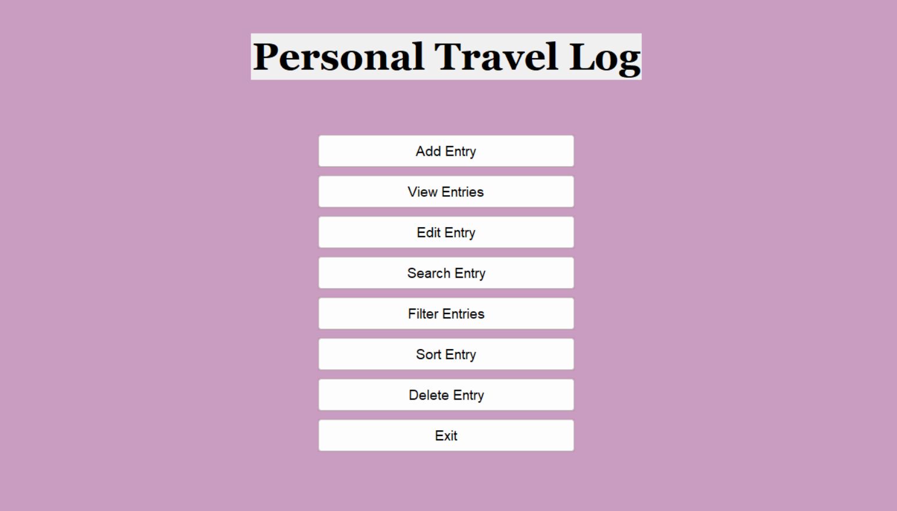
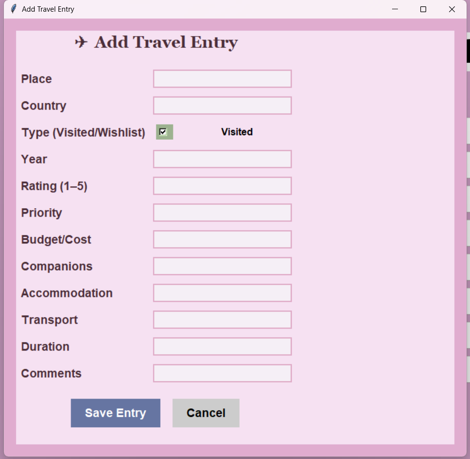
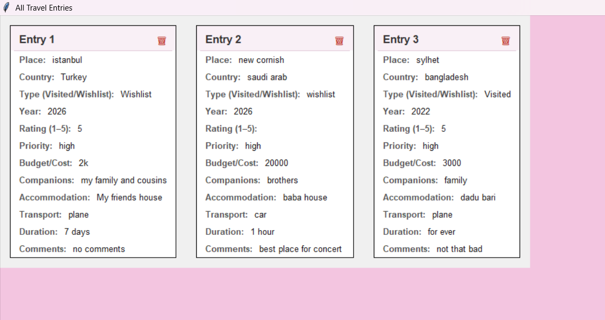

# ✈️ Personal Travel Log System

> 🟢 A **beginner-friendly** Python desktop application to track, manage, and explore your travel memories — built with Python and Tkinter.

---

## 📖 About

**Personal Travel Log System** is a beginner-friendly, GUI-based desktop app built with Python's standard library — no pip installs, no frameworks, no complexity. It lets you log every trip you've taken (or dream of taking). Whether it's a mountain hike in Nepal or a city break in Paris, you can record all the details, search through your memories, and manage your travel bucket list — all in one place, saved locally as JSON.

This project is perfect for **Python beginners** who want to practice:
- Building GUI apps with `tkinter`
- Reading and writing JSON files
- Organising code into classes and methods
- Handling user input and form validation

---

## 🖼️ Screenshots

### 🏠 Main Menu


### ➕ Add Travel Entry


### 🗂️ Card View (with Delete Button)


---

## ✨ Features

| Feature | Description |
|---|---|
| ➕ **Add Entry** | Log a new trip with 12 detailed fields |
| 👁️ **View Entries** | Browse all entries displayed as scrollable cards |
| ✏️ **Edit Entry** | Update any field of an existing entry |
| 🔍 **Search** | Search across all fields by keyword |
| 🔽 **Filter** | Filter entries by Place, Country, Type, Year, Rating, or Priority |
| 🔃 **Sort** | Sort entries ascending or descending by any field |
| 🗑️ **Delete** | Delete entries via a trash icon on each card, with confirmation |
| 💾 **Auto-Save** | All data is automatically saved to `travel_log.json` |

---

## 🗂️ Entry Fields

Each travel entry supports the following fields:

- **Place** — Name of the destination
- **Country** — Country of the destination
- **Type** — Visited ✅ or Wishlist 🌟 (toggle switch)
- **Year** — Year of visit or planned visit
- **Rating** — Your personal rating (1–5)
- **Priority** — How important this trip is to you
- **Budget/Cost** — Estimated or actual cost
- **Companions** — Who you traveled with
- **Accommodation** — Where you stayed
- **Transport** — How you got there
- **Duration** — How long you stayed
- **Comments** — Any personal notes or memories

---

## 🚀 Getting Started

### Prerequisites

- Python **3.6+**
- `tkinter` — included with standard Python installations on Windows and macOS

### Installation

```bash
# Clone the repository
git clone https://github.com/your-username/personal-travel-log.git

# Navigate into the project folder
cd personal-travel-log
```

### Run the App

```bash
python main.py
```

> No additional packages need to be installed — the app uses only Python's standard library.

---

## 📁 Project Structure

```
personal-travel-log/
│
├── main.py            # Main application (all UI and logic)
├── travel_log.json    # Auto-generated data file (created on first save)
└── README.md          # This file
```

---

## 🖼️ App Screens

| Screen | Description |
|---|---|
| **Main Menu** | Central hub with buttons for all features |
| **Add Entry** | Form with 12 styled input fields and a toggle for Visited/Wishlist |
| **Card View** | Horizontal scrollable cards showing all entry details with 🗑️ delete button |
| **Edit Window** | Pre-filled form to update an existing entry |
| **Search Results** | Scrollable text view of matching entries |
| **Filter Window** | Dropdown + value input to narrow down entries |
| **Sort Window** | Pick a field and sort order to reorder all entries |

---

## 💡 How to Use

1. **Launch** the app with `python main.py`
2. Click **Add Entry** to log your first trip — fill in all fields and click **Save Entry**
3. Click **View Entries** to see all your trips as cards
4. Use the **🗑️ trash icon** on any card to delete that entry (with confirmation)
5. Use **Search**, **Filter**, or **Sort** to find specific trips
6. Click **Edit Entry** and enter the entry number to update any trip details

---

## 🛠️ Built With

- **Python 3** — Core language
- **Tkinter** — GUI framework (standard library)
- **JSON** — Local data storage (no database required)

---

## 📄 License

This project is open-source and available under the [MIT License](LICENSE).

---

## 🙋 Author

Made with ❤️ as a **beginner Python learning project**.  
If you're just starting out with Python or Tkinter, this is a great codebase to read, modify, and build on.

Feel free to **fork**, **improve**, and **share**! Contributions and suggestions are always welcome.
